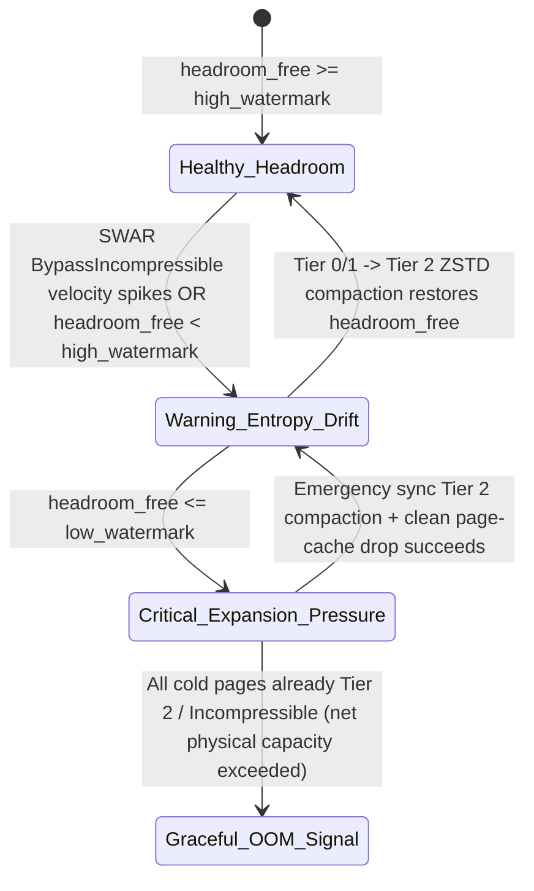

# Fallible Allocation, Decompression Headroom Reserve, and Entropy-Expansion OOM Safety

## 1. Non-Negotiable Reclaim & Page-Fault Safety Invariants

Because `zmem` operates as a whole-memory transient compression layer invoked during memory reclaim (`store_page`) and page-fault handling (`load_page`), it enforces four strict invariants:

1. **Strict `GFP_NOIO` / `GFP_NOWAIT` Discipline:** No allocation inside `store_page`, `load_page`, or background compaction may trigger nested I/O or filesystem reclaim (`__GFP_IO | __GFP_FS`). All dynamic page and metadata allocations use `kernel::alloc::flags::GFP_NOIO` or `GFP_NOWAIT` [@ojeda2021rust].
2. **Fallible Rust Containers Only (`KBox` / `KVec`):** All dynamic allocations return `Result<T, AllocError>`. Infallible panicking allocations are forbidden [@ojeda2021rust].
3. **Pre-Allocated Per-Core / Per-Worker Scratch Workspaces (`[A-RES-05-2]`):** Compression and decompression scratch buffers (`lz4` hash tables, `zstd` `ZSTD_CCtx` / `ZSTD_DCtx` workspaces) are pre-allocated at module init so hot page-fault and compression paths perform zero scratch heap allocations.
4. **No Kernel FPU/SIMD Context Switches:** Hot-path pre-filtering uses pure 64-bit integer SWAR operations on general-purpose registers ([[research/03-algorithms-and-entropy-filtering]]).

## 2. The Sudden Entropy-Increase / Expansion OOM Problem

In a whole-memory transient compression layer, processes can allocate virtual working sets exceeding physical DRAM capacity as long as cold pages compress down (e.g., 3:1 ratio). However, if an application suddenly faults in its **already-allocated** compressed pages and overwrites them with **high-entropy (incompressible) bytes**, two hazards arise simultaneously:
1. **Mid-Fault Deadlock Hazard:** To service a page fault (`load_page`), the kernel needs a free 4 KiB physical page frame to decompress the target page into. If physical memory is 100% full, allocating that destination 4 KiB frame would trigger recursive reclaim and deadlock.
2. **Net Physical Expansion Hazard (`3:1 -> 1:1`):** When 3 compressed pages (occupying ~4 KiB total in Tier 2) are faulted in and overwritten with high-entropy data (`FilterVerdict::BypassIncompressible`), they now require **12 KiB (three 4 KiB frames)** of physical RAM—a net expansion of +8 KiB with zero new virtual memory allocated!

## 3. Decompression Headroom Reserve & Entropy-Expansion State Machine

To test active assumptions `[A-RES-03-3]` and `[A-RES-04-2]`, `zmem` maintains a dedicated **Decompression Headroom Reserve** (`headroom_pool` of pre-allocated 0-order 4 KiB frames) governed by a three-zone watermark state machine:

### State Machine Rules

1. **`Healthy_Headroom` (`headroom_free >= high_watermark`):**
   * Newly unmapped cold pages may stage in Tier 0 (`AsyncStaged`) or compress with fast Tier 1 (`lz4`).
   * Background Tier 1 $\rightarrow$ Tier 2 (`zstd`) demotion is paced gently by CPU and Memory PSI stall counters (`[A-RES-02-2]`).
2. **`Warning_Entropy_Drift` (`low_watermark < headroom_free < high_watermark` or high SWAR `BypassIncompressible` velocity):**
   * Tier 0 staging is bypassed; compressible pages compress directly into Tier 1 (`lz4`).
   * The background worker accelerates Tier 0/1 $\rightarrow$ Tier 2 (`zstd`) compaction to free physical backing frames from `zmem` arenas and replenish `headroom_pool`.
3. **`Critical_Expansion_Pressure` (`headroom_free <= low_watermark`):**
   * Page-fault decompression (`load_page`) is still guaranteed a destination 4 KiB frame from the protected `headroom_pool` so an in-flight fault never deadlocks.
   * Each fault decompression triggers synchronous `shrink_headroom()` compaction of remaining Tier 1 slots into Tier 2 (`zstd`, optionally coalescing into 16 KiB super-blocks) and requests kernel reclamation of discardable clean page-cache folios.
   * **`Graceful_OOM_Signal`:** If all remaining cold slots in `zmem` are already in Tier 2 or flagged `RawHuge` (`BypassIncompressible`) and physical RAM cannot accommodate the expanded working set, `zmem` returns `-ENOMEM` on new `store_page` requests so the kernel invokes the standard OOM killer cleanly—exactly as if a process had over-allocated physical RAM.

## 4. Sharded Size-Class Arena & Super-Block Compaction GC

Inspired by `zsmalloc` [@minchan2014zram] and designed to evaluate active assumption `[A-RES-01-3]`:

* **Per-Core Sharded Arenas:** The small-object arena is partitioned into independent shards to avoid global spinlock contention during parallel background compression and page-fault decompression.
* **0-Order Backing Pages Only:** Size classes chain up to four 0-order (4 KiB) physical pages (`CONFIG_ZSMALLOC_CHAIN_SIZE` pattern [@minchan2014zram]), never requesting higher-order contiguous allocations (`order > 0`).
* **Super-Block Sub-Page Invalidation (`CoalescedSuperBlock<4>`, `[A-RES-04-3]`):**
  * Each 16 KiB Tier 2 super-block header tracks a 4-bit `valid_bitmap` and the 4 constituent `slot_token` IDs.
  * When a constituent 4 KiB page is faulted back to hot RAM (`load_page`) or freed (`evict_slot`), its bit in `valid_bitmap` is cleared atomically.
  * Super-blocks with `valid_bitmap == 0` free their backing arena space immediately; super-blocks with `valid_bitmap.count_ones() <= 2` are linked into a shard-local `fragmented_superblocks` list and repacked by the compaction worker during `Warning_Entropy_Drift` / `shrink_headroom` passes.
