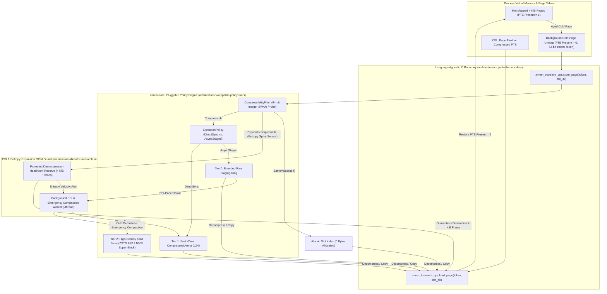

# `zmem` Whole-Memory Transient Compression Architecture and Dataflow

## 1. Core Architectural Concept

`zmem` is an **in-kernel, full-memory transient compression layer** for Linux written in Rust (`rust-for-linux`) [@ojeda2021rust]. Unlike `zram` [@minchan2014zram], which emulates a block swap device (`/dev/zram0`) and forces pages through the disk block I/O layer (`struct bio`), `zmem` operates transparently over system memory (see [[GLOSSARY|Plain-English Glossary]]):

1. **User Sees Only System RAM:** Users do not partition or mount a swap disk. Cold 4 KiB pages in RAM are identified and unmapped in the background (`Present = 0`, storing a 64-bit `zmem` slot token in the non-present PTE), compressed into `zmem`'s in-RAM arenas, and their physical 4 KiB frames are freed back to the kernel page allocator.
2. **Direct Page-Fault Decompression:** When an application accesses a compressed virtual address, the page-fault handler calls `zmem` directly through a language-agnostic C operations table (`struct zmem_transient_ops`, [[architecture/c-ops-table-boundary]]), decompressing the page into a fresh 4 KiB frame from `zmem`'s protected headroom reserve and remapping the PTE (`Present = 1`).
3. **Sudden Entropy-Increase / Expansion OOM Protection:** When an application overwrites already-allocated compressed pages with high-entropy data (e.g., encrypted buffers or quantized ML weights [@weiner2022tmo]), compressed pages expand back to 4 KiB (`1:1`). `zmem` couples its 64-bit integer SWAR pre-filter with a **Decompression Headroom Reserve** and emergency Tier 1 $\rightarrow$ Tier 2 compaction to prevent mid-fault deadlocks and signal clean OOM reclamation when physical capacity is exceeded ([[architecture/allocator-and-reclaim-safety]]).
4. **Two-Layer Implementation with Primary & Sub-Primary Kernel Modes ([[adr/001-rust-blk-mq-entry-point|ADR-001]]):**
   * **Layer 1 (`zmem-core`, `no_std` Rust Engine):** Pure Rust crate operating on `(slot_id, &[u8; 4096])` slices—housing all four swappable policy dimensions (`CompressibilityFilter`, `ExecutionPolicy`, `TierPolicy`, `StorageGranularity`) and fully testable in userspace (`cargo test`).
   * **Layer 2A (Primary Goal — Whole-Memory Transient Mode via `struct zmem_transient_ops`):** Connects `zmem-core` directly to background page scanning and page-fault decompression ([[adr/002-language-agnostic-c-ops-table|ADR-002]]).
   * **Layer 2B (Sub-Primary Goal — Clean-Room Rust `blk-mq` Swap Mode via `kernel::block::mq`):** Exposes `zmem-core` as `/dev/zmem0` (modeled on `rnull`/`rbrd` [@hindborg2024rnull; @axboe2013blkmq]) to benchmark all `zmem-core` policy dimensions directly against stock `/dev/zram0` and to measure the block-layer tax between Layer 2B (`blk-mq` swap) and Layer 2A (direct transient memory).

## 2. End-to-End Whole-Memory Compression, Fault Expansion, and Headroom Dataflow

## 3. Core Subsystem Components

### 3.1 Logical Slot Table (`SlotIndex`)

To test active assumption `[A-RES-01-3]` ([[research/01-linux-mm-and-zram-internals]]), each transient page token maps to an atomic 64-bit `SlotDescriptor` organized into cache-aligned shards:

| Bits | Field | Description |
| :--- | :--- | :--- |
| `63..60` | `TierState` | `Empty (0)`, `SameValue (1)`, `RawHuge (2)`, `Tier0Staged (3)`, `Tier1Fast (4)`, `Tier2Dense (5)`, `Locked (15)` |
| `59..48` | `CompressedLen` | Encoded payload size in bytes ($1..4096$) or sub-page index ($0..3$) for coalesced Tier 2 super-blocks |
| `47..0` | `ArenaHandle` | Compact handle into the corresponding tier's memory arena (or inline 48-bit pattern for `SameValue`) |

### 3.2 Background Compression Path (`store_page`)

1. When a cold 4 KiB page is unmapped, `store_page(slot_idx, &[u8; 4096])` passes the page to `CompressibilityFilter::probe()` ([[research/03-algorithms-and-entropy-filtering]]):
   * **`SameValue(u64)`:** Updates `SlotDescriptor` to `TierState::SameValue` with zero arena allocation, freeing the 4 KiB physical frame immediately.
   * **`BypassIncompressible`:** Fast-bypasses the compressor (`[A-RES-03-2]`), records the incompressible page in the entropy-velocity tracker (`[A-RES-03-3]`), and leaves/stores the raw 4 KiB frame (`TierState::RawHuge`).
2. For compressible pages, `ExecutionPolicy` either stages the page in the bounded **Tier 0 Staging Ring** (`TierState::Tier0Staged`) or compresses it into **Tier 1 (`lz4`)** using pre-allocated per-CPU scratch workspaces (`[A-RES-05-2]`).

### 3.3 Page-Fault Decompression Path (`load_page`)

1. When a process touches a virtual address backed by a `zmem` token, the page-fault handler claims a destination 4 KiB frame (guaranteed by the **Decompression Headroom Reserve**, `[A-RES-04-2]`) and invokes `load_page(slot_idx, &mut [u8; 4096])`.
2. `zmem` atomically looks up `SlotDescriptor`:
   * `SameValue`: Fills the 4 KiB page with the 64-bit word pattern.
   * `RawHuge` / `Tier0Staged`: Reclaims or copies the 4 KiB frame directly.
   * `Tier1Fast`: Decompresses the `lz4` payload directly into the destination 4 KiB slice.
   * `Tier2Dense`: Decompresses the `zstd` payload (or extracts the target 4 KiB sub-page from a 16 KiB super-block) and clears the transient slot (or sub-page validity bit) once the page returns to hot mapped RAM.
