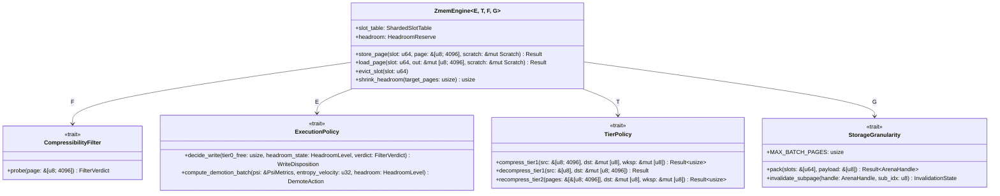

# Swappable Policy Engine and Rust Trait Specifications

## 1. Design Goal: Controlled A/B Scientific Evaluation

Per Core Architectural Rule #4 and [[adr/003-swappable-policy-traits|ADR-003]], `zmem-core` isolates its four primary research dimensions behind orthogonal Rust traits. This enables controlled A/B benchmarking ([[research/06-benchmarking-and-methodology]])—both in userspace trace simulations and inside `virtme-ng`—where a single policy axis is varied while holding the slot index, C ops-table boundary, and sharded arena constant.



## 2. Trait Definitions Across the Four Research Dimensions

### 2.1 Dimension 1: Entropy Pre-Filtering & Entropy-Spike Sensing (`CompressibilityFilter`)

Linked research chapter: [[research/03-algorithms-and-entropy-filtering]].

```rust
#[derive(Copy, Clone, Debug, PartialEq, Eq)]
pub enum FilterVerdict {
    /// All 512 64-bit words equal the given pattern (0 arena bytes allocated).
    SameValue(u64),
    /// High entropy (encrypted buffer, quantized weights); bypass codec & increment entropy-spike sensor.
    BypassIncompressible,
    /// Low/moderate entropy; route to fast Tier 1 compressor.
    CompressFast,
    /// High structural redundancy; eligible for dense compression path.
    CompressDense,
}

pub trait CompressibilityFilter: Send + Sync + 'static {
    fn probe(&self, page: &[u8; 4096]) -> FilterVerdict;
}
```

**Candidate Implementations:**
* `NoopFilter`: Only checks for `SameValue` (matching stock `zram` `page_same_filled` [@minchan2014zram]), returning `CompressFast` for all other pages.
* `SwarCachelineProbe<const LINES: usize>`: Strided 64-bit integer SWAR probe across `LINES` cache lines (default 8 = 512 bytes) without FPU/SIMD state (`[A-RES-03-1]`, `[A-RES-03-2]`).
* `Lz4EarlyAbortProbe`: Executes 4-byte match probing over the first 256 bytes and aborts if match count falls below threshold [@collet2013lz4].

### 2.2 Dimension 2: Execution & Headroom Pacing Model (`ExecutionPolicy`)

Linked research chapters: [[research/02-production-memory-compression]], [[research/04-tiering-coalescing-and-async-reclaim]].

```rust
#[derive(Copy, Clone, Debug, PartialEq, Eq)]
pub enum WriteDisposition {
    /// Stage uncompressed in bounded Tier 0 ring.
    StageTier0,
    /// Compress synchronously into Tier 1 (LZ4).
    SyncCompressTier1,
    /// Emergency high-density compression directly into Tier 2 (ZSTD) when headroom is low.
    EmergencySyncTier2,
}

#[derive(Copy, Clone, Debug, PartialEq, Eq)]
pub enum DemoteAction {
    /// Pause background compression (CPU PSI high and headroom healthy).
    Pause,
    /// Normal background batch demotion from Tier 0 -> Tier 1 -> Tier 2.
    NormalBatch(usize),
    /// Emergency compaction of Tier 0/1 -> Tier 2 to replenish Decompression Headroom Reserve.
    EmergencyCompact(usize),
}
```

**Candidate Implementations:**
* `DirectSyncPolicy`: Always compresses synchronously on `store_page` (`SyncCompressTier1`), isolating synchronous transient compression performance.
* `AsyncPsiHeadroomPolicy`: Stages newly unmapped pages into Tier 0 while free headroom is healthy, paces background demotion via Memory and CPU PSI stall ratios [@weiner2022tmo] (`[A-RES-02-2]`), and switches to `EmergencyCompact` / `EmergencySyncTier2` when `BypassIncompressible` velocity spikes or decompression headroom drops below watermark (`[A-RES-03-3]`, `[A-RES-04-2]`).

### 2.3 Dimension 3: Codec & Tiering Pipeline (`TierPolicy`)

Linked research chapters: [[research/03-algorithms-and-entropy-filtering]], [[research/04-tiering-coalescing-and-async-reclaim]].

```rust
#[derive(Copy, Clone, Debug, PartialEq, Eq)]
pub enum CompressionRegime {
    /// Memory fill < W_low: zero compression overhead; leave pages uncompressed.
    UncompressedNone,
    /// W_low <= Memory fill < W_high: fast LZ4 compression for cold pages.
    FastLz4,
    /// Memory fill >= W_high: high-density ZSTD for new cold pages + background LZ4 -> ZSTD upgrade.
    DenseZstd,
}
```

**Candidate Implementations:**
* `SingleTierLz4`: Always-on single-stage `lz4` compression [@collet2013lz4].
* `SingleTierZstd`: Always-on single-stage `zstd` compression [@collet2016zstd].
* `AgeBasedDualTierLz4ToZstd`: Always compresses newly unmapped pages with `lz4`, then recompresses individual pages to `zstd` based on page age (`[A-RES-04-1]`) [@lagar2019software; @lee2023zramtier].
* `PressureAdaptiveTierPolicy` (`None` $\rightarrow$ `lz4` $\rightarrow$ `zstd`): Dynamically transitions across `CompressionRegime::UncompressedNone`, `FastLz4`, and `DenseZstd` based on system memory fill watermarks ($W_{\text{low}}$, $W_{\text{high}}$ with hysteresis $\Delta W$) and Memory PSI (`[A-RES-04-4]`) [@weiner2022tmo].

### 2.4 Dimension 4: Packing Granularity (`StorageGranularity`)

Linked research chapter: [[research/04-tiering-coalescing-and-async-reclaim]].

* `Fixed4KGranularity`: 1:1 mapping between a 4 KiB logical page token and a compressed object in the size-classed arena (1.0x read amplification, zero sub-page fragmentation).
* `SharedDict4KGranularity`: Compresses each 4 KiB page independently using a shared pre-trained `zstd` dictionary (`dict=` [@minchan2014zram; @collet2016zstd]), testing cross-page redundancy capture at 1.0x read amplification without super-block hole compaction.
* `CoalescedSuperBlock<const N: usize>`: Packs $N=4$ (16 KiB) or $N=8$ (32 KiB) cold 4 KiB pages into a single `zstd` frame with a `valid_bitmap` header and sub-page invalidation tracking (`[A-RES-04-3]`, [[architecture/allocator-and-reclaim-safety]]).

### 2.5 Dimension 5: Expansion-OOM Headroom Protection (`HeadroomPolicy`)

Linked research chapters: [[research/03-algorithms-and-entropy-filtering]], [[research/04-tiering-coalescing-and-async-reclaim]], [[architecture/allocator-and-reclaim-safety]].

* `UnboundedOptimisticHeadroom`: No reserved 4 KiB decompression pool (baseline to measure mid-fault exhaustion risk).
* `StaticFixedHeadroom<const PAGES: usize>`: Fixed $K$-page emergency reserve for `load_page` without proactive entropy-velocity compaction.
* `EntropyVelocityAdaptiveHeadroom`: Couples SWAR `BypassIncompressible` velocity with dynamic reserve watermarks and emergency Tier 1 $\rightarrow$ Tier 2 compaction (`[A-RES-03-3]`, `[A-RES-04-2]`).

## 3. Build-Time Monomorphization vs. Boot-Time Enum Dispatch

To support A/B switching during `virtme-ng` benchmark sweeps ([[research/06-benchmarking-and-methodology]]) without recompiling the kernel between runs, each trait provides a closed `enum` wrapper selectable via module parameters (`insmod zmem.ko filter_policy=swar exec_policy=async_psi tier_policy=lz4_zstd granularity=superblock16k`).
