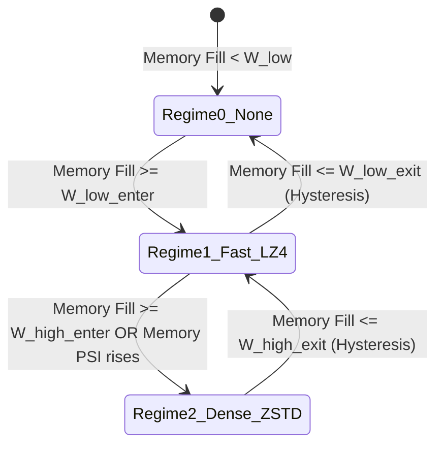

# Background Multi-Tier Demotion, Super-Block Coalescing, and Decompression Headroom Pacing

## Overview

In a **whole-memory transient compression layer**, memory pages transition continuously across temperature tiers:
* **Hot Pages:** Mapped directly in process page tables (`Present = 1`) as uncompressed 4 KiB frames.
* **Warm Transient Pages (Tier 0 / Tier 1):** Recently unmapped cold pages that may be faulted back in shortly. They require sub-microsecond page-fault decompression (`lz4` [@collet2013lz4] or bounded Tier 0 staging).
* **Cold Transient Pages (Tier 2):** Long-lived unmapped pages that have remained unaccessed across multiple background scans (`kstaled` model [@lagar2019software]). These pages are prime candidates for background recompression into high-density **`zstd`** [@collet2016zstd] and multi-page **16 KiB super-block coalescing** ($N=4$ pages).

This chapter analyzes how `zmem` orchestrates background multi-tier demotion (`TierPolicy`), multi-page super-block coalescing (`StorageGranularity`), and **Decompression Headroom Pacing** (`ExecutionPolicy`) when sudden entropy increases cause compressed pages to re-expand.

## Literature Survey & Paper Notes

### Multi-Algorithm Recompression in Mainline `zram` (Verified from Primary Sources)

* **Citation Keys:** `[@minchan2014zram]`, `[@lee2023zramtier]` (verified against `citations/pdfs/minchan2014zram.pdf` and `citations/pdfs/lee2023zramtier.pdf`; see [[citations/sources]])
* **Verified Mechanism:**
  * With `CONFIG_ZRAM_MULTI_COMP`, `zram` supports registering secondary compression algorithms ranked by `priority` (`1..ZRAM_MAX_COMPS`) via `/sys/block/zramX/recomp_algorithm` [@minchan2014zram; @lee2023zramtier].
  * Recompression (`zram_recompress`) is triggered only when external userspace writes `type=idle`, `type=huge`, `type=huge_idle`, or `threshold=<bytes>` to `/sys/block/zramX/recompress`, and operates strictly on individual 4 KiB slots [@minchan2014zram; @lee2023zramtier].

### Sliding-Window Context in `lz4` and `zstd` (Verified from Primary Sources)

* **Citation Keys:** `[@collet2013lz4]`, `[@collet2016zstd]` (verified against `citations/pdfs/collet2013lz4.pdf` and `citations/pdfs/collet2016zstd.pdf`; see [[citations/sources]])
* **Verified Mechanism:**
  * `lz4` encodes match offsets up to 64 KiB (16-bit little-endian offset) [@collet2013lz4], while `zstd` (RFC 8878) supports multi-megabyte sliding windows and shared Huffman literal trees and FSE sequence tables across a frame [@collet2016zstd].
  * Compressing every 4 KiB page in isolation resets the LZ77 history window and entropy tables every 4096 bytes.

## Architectural Implications for `zmem` (Hypotheses Under Design)

### 1. Autonomous Three-Tier Transient Pipeline (`[A-RES-04-1]`)

Detailed in [[architecture/overview-and-dataflow]] and [[architecture/swappable-policy-traits]]:
* **Tier 0 (Bounded Uncompressed Staging Ring — Optional):** Pre-allocated ring of 0-order 4 KiB frames that absorbs newly unmapped pages during sudden memory-pressure spikes without synchronous compression latency. If a page is faulted back in while in Tier 0, it is remapped immediately with zero compression/decompression CPU work.
* **Tier 1 (Warm Fast-Compressed Store):** 4 KiB page-granular slots compressed with `lz4` [@collet2013lz4] for fast page-fault restoration.
* **Tier 2 (Cold High-Density Store):** Background `kthread` worker recompresses aged Tier 1 slots into `zstd` [@collet2016zstd], paced by CPU/Memory PSI stall metrics [@weiner2022tmo].

### 2. Pressure-Based Progressive Compression (`None` $\rightarrow$ `lz4` $\rightarrow$ `zstd`) (`[A-RES-04-4]`)

In a whole-memory transient compression layer, compressing pages when physical RAM is mostly empty wastes CPU and power for zero application benefit. Conversely, waiting until the final few megabytes of free RAM to start compressing with slow `zstd` causes sudden latency cliffs.

To evaluate this trade-off, `zmem` defines a **Pressure-Based Progressive Compression Policy (`PressureAdaptiveTierPolicy`)** driven by physical memory occupancy watermarks ($W_{\text{low}}$, $W_{\text{high}}$) with hysteresis ($\Delta W$) and Memory PSI feedback [@weiner2022tmo]:

1. **Regime 0 — Uncompressed (`None`) [$\text{Memory Fill} < W_{\text{low}}$]:**
   * System memory has ample free pages. `zmem` remains completely passive—zero pages are unmapped or compressed, and applications run at 100% native uncompressed DRAM speed.
2. **Regime 1 — Fast Compression (`lz4`) [$W_{\text{low}} \le \text{Memory Fill} < W_{\text{high}}$]:**
   * As physical memory begins filling up, `zmem` activates cold-page unmapping and fast `lz4` compression [@collet2013lz4] (filtered by `SwarCachelineProbe`). This reclaims ~2:1 physical space on cold pages with minimal CPU and page-fault latency overhead.
3. **Regime 2 — High-Density Compression (`zstd`) [$\text{Memory Fill} \ge W_{\text{high}}$]:**
   * When memory fills further (or when an entropy spike shrinks free headroom), `zmem` switches incoming cold-page compression to **`zstd`** [@collet2016zstd] and dispatches background workers to upgrade existing Regime 1 `lz4` slots into dense Tier 2 `zstd` (and optional 16 KiB super-blocks), maximizing effective RAM capacity (~3:1 ratio [@weiner2022tmo]) before OOM limits are reached.

### 3. Emergency Compaction Under Sudden Entropy Expansion (`[A-RES-04-2]`)

When a process overwrites already-allocated compressed pages with high-entropy data ([[research/03-algorithms-and-entropy-filtering]]), each faulted page expands from its compressed Tier 1/2 size back to a full 4 KiB physical frame:
* If free physical frames in the **Decompression Headroom Reserve** drop below the low watermark, `zmem` switches from passive PSI-paced demotion to **Emergency Compaction Mode** ([[architecture/allocator-and-reclaim-safety]]):
  1. Immediately drains Tier 0 into Tier 1 (`lz4`).
  2. Accelerates Tier 1 (`lz4`) $\rightarrow$ Tier 2 (`zstd`) recompression of cold compressible pages to free physical backing frames back to the headroom reserve.
  3. If physical memory remains exhausted because the working set has become incompressible, cleanly signals the kernel OOM path rather than deadlocking mid-fault.

### 4. Cold Super-Block Coalescing & Sub-Page Invalidation (`[A-RES-04-3]`)

When `StorageGranularity` is set to `CoalescedSuperBlock<4>` (16 KiB logical window = four 4 KiB pages) in Tier 2:
* Each super-block header tracks a 4-bit `valid_bitmap` and the logical slot tokens of its 4 constituent pages.
* When one of the 4 pages is faulted back in and dirtied (or freed by `munmap`/`exit`), its bit in `valid_bitmap` is cleared atomically.
* Half-invalidated super-blocks ($\le 2$ valid pages) are queued for background compaction ([[architecture/allocator-and-reclaim-safety]]).

## Same-Level Peer Alternatives to Test Against

To evaluate tiering, packing granularity, and expansion-OOM headroom protection without confounding variables, `zmem` defines peer alternatives across three orthogonal trait dimensions:

### 1. Tiering Strategy Alternatives (`TierPolicy` Trait)

| Alternative ID | Tiering Progression | Trigger Condition | Expected Strength | Expected Cost / Failure Mode |
| :--- | :--- | :--- | :--- | :--- |
| **`Tier::SingleStaticFast` (`lz4` only)** | All compressed pages stay in Tier 1 (`lz4`) permanently | Always-on static | Lowest compression & page-fault latency; zero background recompression CPU cost | Lower effective compression ratio (~2:1); hits OOM earlier under heavy memory pressure |
| **`Tier::SingleStaticDense` (`zstd` only)** | All compressed pages go directly into `zstd` | Always-on static | Maximum immediate memory density (~3:1 `[@weiner2022tmo]`) | High synchronous compression CPU cost and P99/P99.9 latency on every unmapped page |
| **`Tier::PerPageAgeCascaded` (`Tier 0 -> lz4 -> zstd`)** | Each page enters Tier 0 (raw) $\rightarrow$ Tier 1 (`lz4`) $\rightarrow$ demotes to Tier 2 (`zstd`) when page age $> T_{\text{cold}}$ | Per-page dwell time / age (`kstaled` model `[@lagar2019software]`) | Absorbs short-lived churn in fast tiers while packing long-lived cold pages densely | Still runs `lz4` and background `zstd` even when total system RAM usage is low |
| **`Tier::PressureProgressive` (`None -> lz4 -> zstd`)** | Global regime escalates by memory fill watermarks ($W_{\text{low}}, W_{\text{high}}$ with hysteresis $\Delta W$) and PSI | System-wide memory fill & Memory PSI | **Zero** compression overhead when RAM is ample (`< W_low`); fast `lz4` at moderate fill; dense `zstd` only when needed | Requires background `lz4` $\rightarrow$ `zstd` upgrade wave when crossing $W_{\text{high}}$ |
| **`Tier::SizeThresholdRecompress` (Mainline `zram` model)** | Compresses with `lz4` first; recompresses with `zstd` only slots whose compressed size exceeds `<threshold>` bytes | Compressed object size (`recompress threshold=` `[@minchan2014zram; @lee2023zramtier]`) | Targets recompression CPU specifically at poorly compressed `lz4` slots | Misses additional `zstd` savings on already-moderate (e.g., 1.5 KiB $\rightarrow$ 900 B) cold pages |

### 2. Packing Granularity Alternatives (`StorageGranularity` Trait)

| Alternative ID | Logical Window | Cross-Page Context Mechanism | Read Amplification on 4 KiB Fault | Fragmentation / Compaction Cost |
| :--- | :--- | :--- | :--- | :--- |
| **`Granularity::Fixed4KiB`** | 4 KiB (1 page) | None (dictionary resets every 4 KiB) | **1.0x** (decompresses exactly 4 KiB) | None (1:1 slot-to-object lifecycles) |
| **`Granularity::SharedDict4KiB`** | 4 KiB (1 page) + shared pre-trained `zstd` dictionary | Static/periodic shared dictionary (`dict=` `[@minchan2014zram; @collet2016zstd]`) | **1.0x** (decompresses single 4 KiB page using shared dict) | Zero sub-page hole fragmentation; requires representative dictionary training |
| **`Granularity::CoalescedSuperBlock16KiB` ($N=4$)** | 16 KiB (4 cold pages) | Full dynamic 16 KiB LZ77 sliding window + shared FSE/Huffman tables | **Up to 4.0x** (decompresses up to target sub-page offset) | Requires 4-bit `valid_bitmap` and background hole compaction when $\le 2$ sub-pages remain valid |
| **`Granularity::CoalescedSuperBlock32KiB` ($N=8$)** | 32 KiB (8 cold pages) | Full dynamic 32 KiB LZ77 sliding window + shared FSE/Huffman tables | **UpTo 8.0x** (high page-fault tail-latency penalty) | High sub-page invalidation churn; tests upper limit of super-block sizing |

### 3. Expansion-OOM Headroom Protection Alternatives

| Alternative ID | Headroom & Entropy-Spike Policy | Expected Behavior Under Sudden 3:1 $\rightarrow$ 1:1 Entropy Increase |
| :--- | :--- | :--- |
| **`Headroom::UnboundedOptimistic`** | No reserved 4 KiB decompression pool; allocates on demand | High risk of mid-fault allocation failure or recursive reclaim deadlock when RAM is 100% full |
| **`Headroom::StaticFixedReserve`** | Fixed $K$-page emergency pool for `load_page`, no proactive entropy-velocity compaction | Survives brief fault bursts of size $< K$, but exhausts reserve under sustained high-entropy overwrites |
| **`Headroom::EntropyVelocityAdaptive` (`zmem` target)** | Couples SWAR `BypassIncompressible` velocity with dynamic reserve watermarks and emergency Tier 1 $\rightarrow$ Tier 2 compaction | Proactively compacts cold pages as entropy rises and triggers clean OOM signaling before reserve exhaustion |

## Assumptions

- [ ] **Active:** `[A-RES-04-1]` An autonomous in-kernel pipeline (bounded Tier 0 staging $\rightarrow$ Tier 1 `lz4` $\rightarrow$ PSI-paced Tier 2 `zstd`) achieves lower page-reclaim tail latency than synchronous single-tier `zstd` while approaching single-tier `zstd` effective compression ratios on aged working sets. #assumption
- [ ] **Active:** `[A-RES-04-2]` Maintaining a protected Decompression Headroom Reserve coupled with emergency Tier 1 $\rightarrow$ Tier 2 compaction prevents page-fault decompression deadlocks when workloads suddenly overwrite compressed memory with high-entropy data ([[architecture/allocator-and-reclaim-safety]]). #assumption
- [ ] **Active:** `[A-RES-04-3]` Coalescing $N=4$ cold 4 KiB pages into a 16 KiB Tier 2 `zstd` super-block improves effective compression ratio ($\text{CR}_{\text{eff}}$) over isolated 4 KiB `zstd` pages by sharing the LZ77 sliding window and FSE/Huffman tables (`[@collet2016zstd]`), while keeping page-fault latency bounded when restricted to cold pages. #assumption
- [ ] **Active:** `[A-RES-04-4]` Pressure-based progressive compression (`PressureAdaptiveTierPolicy`: starting with `None` below $W_{\text{low}}$, activating `lz4` above $W_{\text{low}}$, and escalating to `zstd` plus background `lz4` $\rightarrow$ `zstd` recompression above $W_{\text{high}}$) achieves higher **Saved Memory per CPU Cycle ($\eta_{\text{mem/cpu}}$)** across variable-load and `malloc`/`free` churn tests than always-on static `zstd`, while matching static `zstd` capacity limits under heavy memory pressure. #assumption

## What Was Tried

* **Source Analysis of `zram_recompress` (`drivers/block/zram/zram_drv.c`) & Headroom Modeling:** Audited mainline `zram`'s single-page sysfs recompression loop [@lee2023zramtier] and modeled the physical frame balance during a sudden 3:1 $\rightarrow$ 1:1 entropy expansion event to design `zmem`'s Decompression Headroom Reserve ([[architecture/allocator-and-reclaim-safety]]).

## Conclusions

* **From Literature (`[@minchan2014zram; @lee2023zramtier; @collet2013lz4; @collet2016zstd]`):** Mainline `zram` multi-algorithm recompression operates strictly on single 4 KiB pages via manual userspace sysfs triggers, whereas `lz4` (64 KiB window) and `zstd` (multi-megabyte window + FSE/Huffman tables) can exploit cross-page redundancy when given multi-page windows.
* **For `zmem`:** Autonomous PSI-paced tiering (`[A-RES-04-1]`), decompression headroom protection under sudden entropy expansion (`[A-RES-04-2]`), and 16 KiB cold super-block coalescing (`[A-RES-04-3]`) remain active hypotheses awaiting experimental verification in [[experiments/README|docs/experiments/]].

## Revision Log

| Date | Change | Trigger |
| :--- | :--- | :--- |
| 2026-11-21 | Added Decompression Headroom Pacing for sudden entropy-expansion events and verified `zram_drv.c` recompression | Core concept pivot & [[adr/003-swappable-policy-traits\|ADR-003]] |
